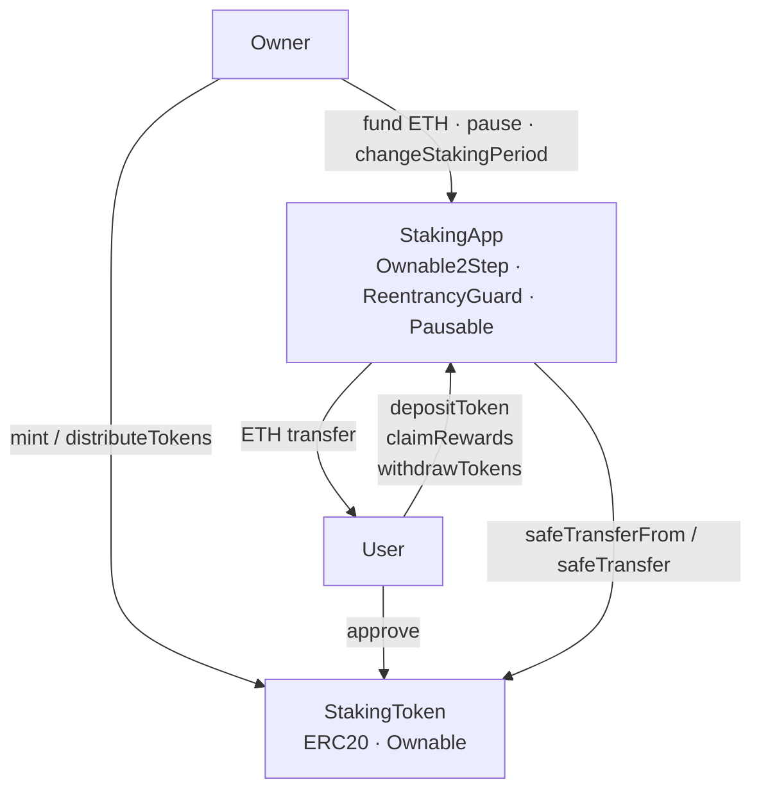
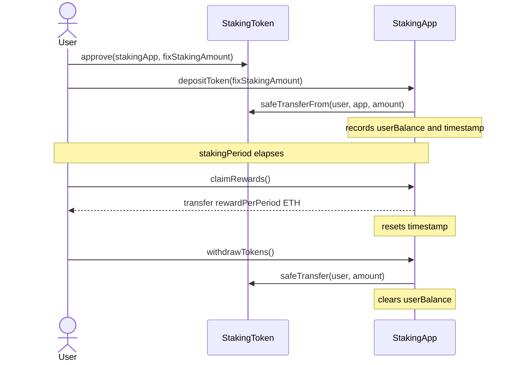

# Staking Protocol

A fixed-amount ERC20 staking protocol on Ethereum. Users lock a fixed token amount for a configurable period and claim ETH rewards. The protocol is owner-managed and includes an emergency pause mechanism.


---

## Overview

The protocol consists of two contracts:

- **`StakingToken`** — a mintable ERC20 with a hard cap of 1,000,000 tokens and a batch distribution function for airdrops.
- **`StakingApp`** — accepts deposits of exactly `fixStakingAmount` tokens, tracks staking timestamps, and pays `rewardPerPeriod` ETH after each completed `stakingPeriod`. The owner funds the contract with ETH via `receive()` and can pause deposits and reward claims in an emergency without blocking withdrawals.

## Example

1. Owner deploys both contracts, setting a 30-day staking period, a fixed amount of 1 STK, and a 0.01 ETH reward per period.
2. Owner mints tokens and funds `StakingApp` with ETH.
3. User approves `StakingApp` to spend 1 STK and calls `depositToken(1e18)`.
4. After 30 days, user calls `claimRewards()` and receives 0.01 ETH. The staking period resets — the user can claim again after another 30 days without re-depositing.
5. User can call `withdrawTokens()` at any time to recover the staked tokens, including while the contract is paused.

## Architecture



### Staking flow



## Key Features

| Feature | Detail |
|---|---|
| Fixed-amount staking | Each user holds at most one active position of exactly `fixStakingAmount` tokens |
| Periodic ETH rewards | Fixed ETH payout per completed staking period; period resets on each claim |
| Emergency pause | Owner can pause `depositToken` and `claimRewards`; `withdrawTokens` is always open |
| Safe token transfers | `SafeERC20` wraps all ERC20 calls to handle non-standard return values |
| Two-step ownership | `Ownable2Step` prevents accidental ownership transfers |
| Typed custom errors | All reverts use Solidity custom errors with parameters for gas efficiency and debuggability |
| Indexed events | `DepositTokens`, `WithdrawTokens` and `RewardsClaimed` index the user address for off-chain filtering |

## Contract Reference

### StakingApp

| Function | Access | Description |
|---|---|---|
| `depositToken(uint256)` | public · whenNotPaused | Deposits exactly `fixStakingAmount` tokens (once per user) |
| `withdrawTokens()` | public | Returns staked tokens; always available, even when paused |
| `claimRewards()` | public · whenNotPaused | Transfers `rewardPerPeriod` ETH after staking period elapses |
| `pause() / unpause()` | onlyOwner | Toggles emergency pause |
| `changeStakingPeriod(uint256)` | onlyOwner | Updates the required staking duration |
| `receive()` | onlyOwner | Funds the contract with ETH for reward payouts |

### StakingToken

| Function | Access | Description |
|---|---|---|
| `mint(uint256)` | onlyOwner | Mints tokens up to `MAX_SUPPLY` (1,000,000 STK) |
| `distributeTokens(address[], uint256[])` | onlyOwner | Batch transfer for initial distribution |

## Security

| Measure | Where applied |
|---|---|
| CEI (Check-Effects-Interactions) | `withdrawTokens` — state cleared before external transfer |
| `ReentrancyGuard` | All three user-facing functions |
| `SafeERC20` | `depositToken` and `withdrawTokens` |
| `Ownable2Step` | Ownership transfers require explicit acceptance |
| `Pausable` | `depositToken` and `claimRewards` gated; `withdrawTokens` intentionally excluded |
| `immutable` | `stakingToken`, `fixStakingAmount`, `rewardPerPeriod` — cheaper reads, explicit intent |
| Custom errors with parameters | All reverts — `IncorrectAmount(expected, provided)`, `StakingPeriodNotElapsed(remaining)`, etc. |

The reentrancy test includes a purpose-built `ReentrantAttacker` contract that attempts to re-enter `claimRewards` inside the ETH `receive` hook, confirming `ReentrancyGuard` blocks it correctly.

## Testing

62 tests across five suites (`forge test`):

| Suite | Type | Coverage |
|---|---|---|
| `StakingAppTest.t.sol` | Unit — happy path, reverts, access control, pause | `StakingApp`: 100% lines |
| `StakingTokenTest.t.sol` | Unit — mint, distribute, access control | `StakingToken`: 100% lines |
| `StakingAppFuzz.t.sol` | Fuzz — deposit amount boundaries, claim timing, period config | 256 runs per test |
| `StakingAppInvariant.t.sol` | Invariant — token balance, ETH balance and NFT ownership consistency | 256 sequences · 32,768 calls each |

CI runs `forge fmt --check`, `forge build`, `forge test` (higher fuzz runs via `FOUNDRY_PROFILE=ci`), a line-coverage gate of 95% on `src/`, `forge snapshot --check` and Slither static analysis on every push. See also [SECURITY.md](SECURITY.md). The gas snapshot blocks any unreviewed gas regression from merging; Slither blocks any new finding in `src/`.

**Gas (median, production functions):**

| Function | Median gas |
|---|---|
| `depositToken` | ~75,000 |
| `withdrawTokens` | ~47,000 |
| `claimRewards` | ~38,000 |

## Tech Stack

- **Solidity** `^0.8.24` — compiled with `solc 0.8.35`
- **Foundry** `1.7.1` — Forge, Anvil, Cast
- **OpenZeppelin Contracts** `v5.7.0` — ERC20, SafeERC20, Ownable2Step, ReentrancyGuard, Pausable
- **forge-std** `v1.16.2`

## Getting Started

**Prerequisites:** [Foundry](https://book.getfoundry.sh/getting-started/installation)

```bash
git clone --recurse-submodules https://github.com/sergiiogg7/staking-protocol.git
cd staking-protocol
forge build
forge test
```

**Run with gas report:**
```bash
forge test --gas-report
```

**Check gas regressions against snapshot:**
```bash
forge snapshot --check
```

**Deploy locally (requires Anvil running):**
```bash
cp .env.example .env   # fill in values
source .env
forge script script/Deploy.s.sol --rpc-url $RPC_URL --private-key $PRIVATE_KEY --broadcast
```

## Project Structure

```
src/
  StakingApp.sol        # Core staking logic
  StakingToken.sol      # ERC20 staking asset
script/
  Deploy.s.sol          # Reproducible deployment script
test/
  StakingAppTest.t.sol  # Unit tests
  StakingTokenTest.t.sol
  StakingAppFuzz.t.sol  # Fuzz tests
  StakingAppInvariant.t.sol  # Invariant tests with handler
.github/workflows/
  test.yml              # CI: fmt · build · test · gas snapshot
.env.example            # Deployment configuration template
```
