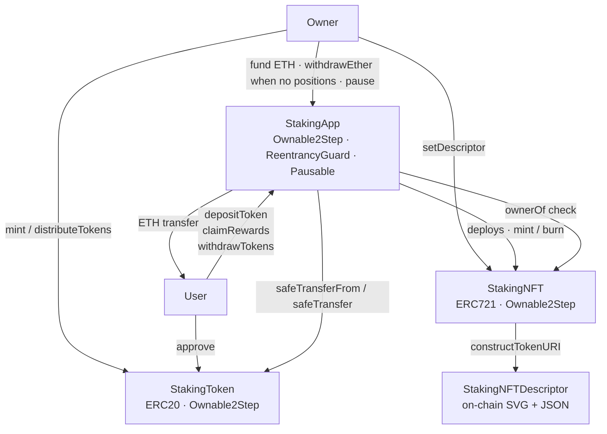

# Staking Protocol

A fixed-amount ERC20 staking protocol on Ethereum. Users lock a fixed token amount and claim ETH rewards for every completed staking period. Each position is an ERC-721 NFT that doubles as a bearer title: whoever owns it controls the position. The protocol is owner-managed and includes an emergency pause mechanism.


---

## Overview

The protocol consists of four contracts:

- **`StakingToken`** — a mintable ERC20 with a hard cap of 1,000,000 tokens and a batch distribution function for airdrops.
- **`StakingApp`** — accepts deposits of exactly `fixStakingAmount` tokens, tracks a timer per position, and pays `rewardPerPeriod` ETH for each completed `stakingPeriod`. It deploys its own `StakingNFT` in the constructor. The owner funds the contract with ETH via `receive()` and can pause deposits and reward claims in an emergency without blocking withdrawals.
- **`StakingNFT`** — the ERC-721 that represents each position. Only `StakingApp` can mint and burn it.
- **`StakingNFTDescriptor`** — renders the NFT metadata on-chain (SVG and JSON as base64 data URIs). It can be replaced through `StakingNFT.setDescriptor` without touching positions.

The staking period, the fixed amount and the reward are `immutable`: they are set at deployment and cannot change under open positions.

## Example

1. Owner deploys the token, the descriptor and `StakingApp` (which creates the NFT), setting a 30-day staking period, a fixed amount of 1 STK, and a 0.01 ETH reward per period.
2. Owner mints tokens and funds `StakingApp` with ETH.
3. User approves `StakingApp` to spend 1 STK and calls `depositToken(1e18)`. The call mints a position NFT and returns its `tokenId`.
4. After 30 days, the owner of the NFT calls `claimRewards(tokenId)` and receives 0.01 ETH. Rewards accrue per completed period: claiming after 75 days pays 2 × 0.01 ETH and the remaining 15 days keep counting toward the next period. No re-deposit is needed.
5. The owner of the NFT can call `withdrawTokens(tokenId)` at any time to recover the staked tokens and burn the NFT, including while the contract is paused.

The NFT is a bearer instrument: whoever owns it controls the position. Transferring the NFT transfers the right to claim and withdraw, together with the staking time already accrued.

## Architecture



### Staking flow

```mermaid
sequenceDiagram
    actor User
    participant StakingToken
    participant StakingApp
    participant StakingNFT

    User->>StakingToken: approve(stakingApp, fixStakingAmount)
    User->>StakingApp: depositToken(fixStakingAmount)
    StakingApp->>StakingNFT: mint(user, amount, timestamp)
    StakingApp->>StakingToken: safeTransferFrom(user, app, amount)
    Note over StakingApp: records lastActivity[tokenId]

    Note over User,StakingApp: stakingPeriod elapses

    User->>StakingApp: claimRewards(tokenId)
    Note over StakingApp: requires ownerOf(tokenId) == user
    StakingApp-->>User: transfer rewardPerPeriod ETH per completed period
    Note over StakingApp: advances lastActivity[tokenId] by whole periods

    User->>StakingApp: withdrawTokens(tokenId)
    StakingApp->>StakingNFT: burn(tokenId)
    StakingApp->>StakingToken: safeTransfer(user, amount)
    Note over StakingApp: clears lastActivity[tokenId]
```



## Key Features

| Feature | Detail |
|---|---|
| Fixed-amount staking | Each position holds exactly `fixStakingAmount` tokens; an address can open several positions |
| Transferable positions | Each position is an ERC-721; the NFT owner (not an approved operator) can claim and withdraw |
| Periodic ETH rewards | Fixed ETH payout per completed staking period; unclaimed periods accumulate and the leftover time is kept |
| Emergency pause | Owner can pause `depositToken` and `claimRewards`; `withdrawTokens` is always open |
| Safe token transfers | `SafeERC20` wraps all ERC20 calls to handle non-standard return values |
| Two-step ownership | `Ownable2Step` on `StakingApp`, `StakingToken` and `StakingNFT` prevents accidental ownership transfers |
| Typed custom errors | All reverts use Solidity custom errors with parameters for gas efficiency and debuggability |
| Indexed events | `DepositTokens`, `WithdrawTokens` and `RewardsClaimed` index the user address for off-chain filtering |

## Contract Reference

### StakingApp

| Function | Access | Description |
|---|---|---|
| `depositToken(uint256)` | public · whenNotPaused | Deposits exactly `fixStakingAmount` tokens, mints a position NFT and returns its `tokenId` |
| `withdrawTokens(uint256 tokenId)` | NFT owner | Returns staked tokens and burns the NFT; always available, even when paused |
| `claimRewards(uint256 tokenId)` | NFT owner · whenNotPaused | Transfers `rewardPerPeriod` ETH for every completed staking period |
| `claimableRewards(uint256 tokenId)` | view | ETH that `claimRewards` would pay right now (0 for unknown positions) |
| `pause() / unpause()` | onlyOwner | Toggles emergency pause |
| `receive()` | onlyOwner | Funds the contract with ETH for reward payouts |
| `withdrawEther()` | onlyOwner | Sends the whole ETH balance to the owner; only allowed when no position is open |

### StakingToken

| Function | Access | Description |
|---|---|---|
| `mint(uint256)` | onlyOwner | Mints tokens up to `MAX_SUPPLY` (1,000,000 STK) |
| `distributeTokens(address[], uint256[])` | onlyOwner | Batch transfer for initial distribution |

## Security

| Measure | Where applied |
|---|---|
| CEI (Check-Effects-Interactions) | `withdrawTokens` — state cleared before external transfer |
| `ReentrancyGuard` | `depositToken`, `claimRewards`, `withdrawTokens` and `withdrawEther` |
| `SafeERC20` | `depositToken` and `withdrawTokens` |
| `Ownable2Step` | Ownership transfers require explicit acceptance |
| `Pausable` | `depositToken` and `claimRewards` gated; `withdrawTokens` intentionally excluded |
| `immutable` | `stakingToken`, `stakingNFT`, `stakingPeriod`, `fixStakingAmount`, `rewardPerPeriod` — cheaper reads, and the economic terms cannot change under open positions |
| Custom errors with parameters | All reverts — `IncorrectAmount(expected, provided)`, `StakingPeriodNotElapsed(remaining)`, etc. |

The reentrancy test includes a purpose-built `ReentrantAttacker` contract that attempts to re-enter `claimRewards` inside the ETH `receive` hook, confirming `ReentrancyGuard` blocks it correctly.

## Testing

106 tests across six suites (`forge test`), with 100% line coverage of `src/`:

| Suite | Type | Coverage |
|---|---|---|
| `StakingAppTest.t.sol` | Unit — deposits, multi-period claims, bearer semantics after an NFT transfer, `withdrawEther`, access control, pause | `StakingApp`: 100% lines |
| `StakingNFTTest.t.sol` | Unit — mint and burn authorization, token URI, descriptor swap, two-step ownership | `StakingNFT`: 100% lines |
| `StakingNFTDescriptor.t.sol` | Unit — exact JSON and SVG output | `StakingNFTDescriptor` |
| `StakingTokenTest.t.sol` | Unit — mint, distribute, access control, two-step ownership | `StakingToken`: 100% lines |
| `StakingAppFuzz.t.sol` | Fuzz — deposit amounts, claim timing and payout for any elapsed time, period bounds at deployment | 256 runs per test |
| `StakingAppInvariant.t.sol` | Invariant — token and ETH balances, positions with a running timer, NFT balances, nothing claimable right after a claim, ETH never withdrawn while a position is open | 256 sequences · 32,768 calls each |

CI runs `forge fmt --check`, `forge build`, `forge test` (higher fuzz runs via `FOUNDRY_PROFILE=ci`), a line-coverage gate of 95% on `src/`, `forge snapshot --check` and Slither static analysis on every push. See also [SECURITY.md](SECURITY.md). The gas snapshot blocks any unreviewed gas regression from merging; Slither blocks any new finding in `src/`.

**Gas (median over the unit suites, `forge test --gas-report`):**

| Function | Median gas |
|---|---|
| `depositToken` | ~220,000 (includes minting the NFT) |
| `withdrawTokens` | ~82,000 (includes burning the NFT) |
| `claimRewards` | ~46,000 |
| `claimableRewards` (view) | ~3,000 |

## Tech Stack

- **Solidity** `0.8.24` — pinned in `foundry.toml`, EVM version `cancun`
- **Foundry** `1.7.1` — Forge, Anvil, Cast
- **OpenZeppelin Contracts** `v5.7.0` — ERC20, ERC721, SafeERC20, Ownable2Step, ReentrancyGuard, Pausable, Base64, Strings
- **forge-std** `v1.16.2`

## Getting Started

**Prerequisites:** [Foundry](https://book.getfoundry.sh/getting-started/installation)

```bash
git clone --recurse-submodules https://github.com/sergiiogg7/staking-protocol.git
cd staking-protocol
forge build
forge test
```

**Run with gas report:**
```bash
forge test --gas-report
```

**Check gas regressions against snapshot:**
```bash
forge snapshot --check
```

**Deploy locally (requires Anvil running):**
```bash
cp .env.example .env   # fill in values
source .env
forge script script/Deploy.s.sol --rpc-url $RPC_URL --private-key $PRIVATE_KEY --broadcast
```

## Project Structure

```
src/
  StakingApp.sol        # Core staking logic; deploys the StakingNFT
  StakingToken.sol      # ERC20 staking asset
  StakingNFT.sol        # ERC721 position receipt and bearer title
  StakingNFTDescriptor.sol  # On-chain SVG + JSON metadata
  ITokenURIDescriptor.sol   # Renderer interface
script/
  Deploy.s.sol          # Reproducible deployment script
  LocalDeploy.s.sol     # Anvil deployment with seeded accounts (used by dev.sh)
dev.sh                  # Starts Anvil and deploys for local testing
test/
  StakingAppTest.t.sol  # Unit tests
  StakingNFTTest.t.sol
  StakingNFTDescriptor.t.sol
  StakingTokenTest.t.sol
  StakingAppFuzz.t.sol  # Fuzz tests
  StakingAppInvariant.t.sol  # Invariant tests with handler
.github/workflows/
  test.yml              # CI: fmt · build · test · gas snapshot
.env.example            # Deployment configuration template
```
